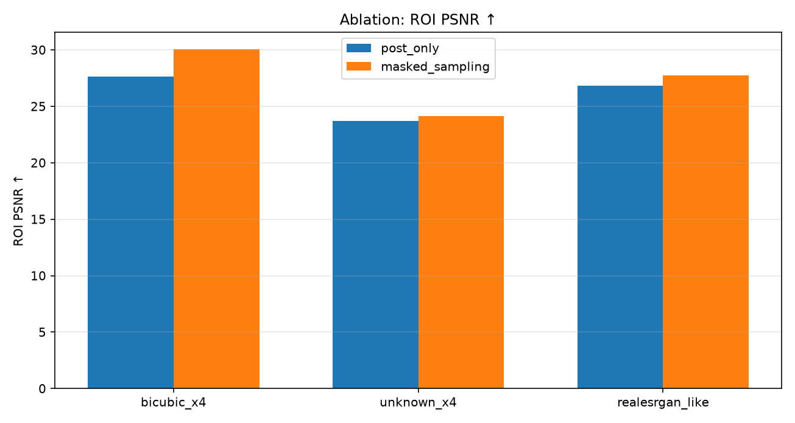
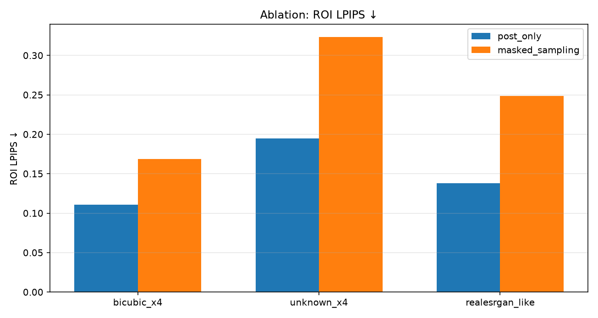
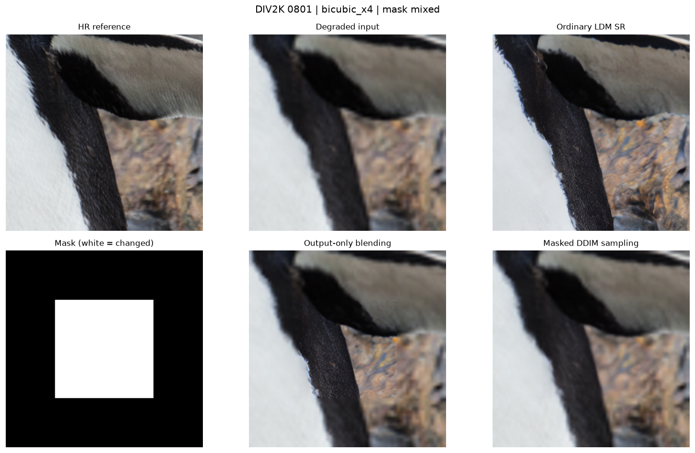
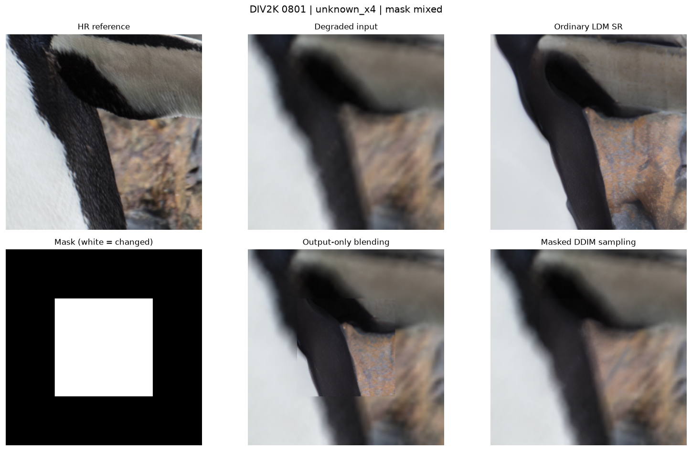

# Лабораторная работа №3

**Модификация диффузионного сэмплинга для локального повышения разрешения изображений (SR-inpainting)**

Предобученная модель LDM · DDIM · DIV2K · Apple MPS

**Цель работы.** Разработать и экспериментально оценить модификацию процесса сэмплинга предобученной диффузионной модели, обеспечивающую восстановление только области, заданной бинарной маской, при сохранении остальных пикселей исходного деградированного изображения.

| Параметр | Значение |
| --- | --- |
| Модель | CompVis/ldm-super-resolution-4x-openimages |
| Среда | macOS, Apple Silicon / MPS, Python 3.12 |
| Данные | DIV2K validation: 0801, 0802, 0803 |
| Условия | 3 деградации × 3 маски × 2 метода |
| Метрики | PSNR, LPIPS, CLIP-IQA (полное изображение и ROI) |

Исследуется изменение DDIM-сэмплинга в латентном пространстве с принудительным восстановлением неизменяемой области на каждом шаге. Сравниваются постобработка готового SR-результата и вмешательство непосредственно в сэмплинг. По трём изображениям модифицированный алгоритм повышает ROI PSNR для всех деградаций, но ухудшает перцептивные оценки внутри маски.

## 1. Теоретическая база

### 1.1. Сверхразрешение и локальное восстановление

Super-resolution (SR) — задача восстановления изображения высокого разрешения (HR) по изображению низкого разрешения (LR). При масштабировании ×4 каждая сторона LR-изображения меньше соответствующей стороны HR в четыре раза; пропавшие высокочастотные детали нельзя восстановить обычной интерполяцией без приближений. В данной работе рассматривается вариант SR-inpainting: улучшение производится лишь в области интереса, а исходные значения пикселей вне неё должны сохраняться.

Маска M ∈ {0, 1}^(H×W) имеет ту же пространственную размерность, что выходное HR-изображение. Значение M = 1 означает область для восстановления, M = 0 — область, которую следует оставить неизменной. Используются три предельных и промежуточных случая: полностью белая, полностью чёрная и центральная квадратная маска.

### 1.2. Диффузионная модель в латентном пространстве

Диффузионные модели постепенно преобразуют шум в изображение. На прямом процессе к представлению изображения добавляют шум, на обратном — нейронная сеть прогнозирует шум и итеративно восстанавливает структуру данных. В Latent Diffusion Model (LDM) вычисления проводятся в сжатом представлении, что снижает требования к памяти и вычислениям по сравнению с обработкой всех HR-пикселей [1, 2].

Использована предобученная LDM Super-Resolution 4× (CompVis), включающая VQ-VAE для преобразования изображения и условную U-Net для денойзинга. Вход низкого разрешения служит условием, а после обратной диффузии VQ-декодер преобразует латентное представление в HR-изображение. Дополнительное обучение сети не выполнялось.

### 1.3. DDIM и идея модификации сэмплинга

DDIM (Denoising Diffusion Implicit Models) — способ выполнять обратную диффузию за ограниченное число шагов. На каждом шаге U-Net вычисляет прогноз шума, после чего DDIM-планировщик рассчитывает следующее латентное состояние [3]. В работе использовано 12 шагов и детерминированный режим η = 0.

Обычная генерация изменяет всё изображение. Предлагаемый алгоритм после каждого DDIM-перехода заменяет латентные значения вне маски зашумлённым опорным латентом, полученным из деградированного входа. Это и есть основное изменение алгоритма: ограничение действует на протяжении диффузии, а не только в конце.

### 1.4. Метрики качества

**PSNR ↑.** Пиковое отношение сигнал/шум характеризует близость пикселей к эталону HR; большее значение означает меньшую среднеквадратичную ошибку. ROI PSNR рассчитывается только по пикселям с M = 1. При полностью нулевой маске ROI не определён.

Для 8-битного RGB-изображения PSNR = 10·log₁₀(255²/MSE), где MSE — среднее квадратичное отклонение от HR-эталона. Для ROI усреднение производится только по выбранным маской пикселям.

**LPIPS ↓.** Перцептивное расстояние между признаками изображений в сети AlexNet; меньшее значение означает большее сходство с HR по признакам модели [5]. Для ROI в программе оценивается прямоугольная ограничивающая область (bounding box), а не произвольная пиксельная маска.

**CLIP-IQA ↑.** Безэталонная оценка визуального качества на основе модели CLIP с промптами качества. В отличие от PSNR и LPIPS, сравнение с HR для неё не требуется [6]. Оценка ROI также производится по bounding box.

## 2. Описание разработанной системы

### 2.1. Архитектура и компоненты

Система реализована одним Python-скриптом sr_inpainting_local_fixed.py на PyTorch, Diffusers, NumPy и TorchMetrics. Для инференса применяется Apple Metal Performance Shaders (MPS); LPIPS и CLIP-IQA рассчитываются на CPU. Модель загружается из репозитория CompVis на Hugging Face. Веса не обучаются заново.

| Блок | Назначение |
| --- | --- |
| DIV2K / подготовка | Загрузка трёх HR-изображений и, для unknown ×4, готовых LR-пар; вырезание согласованных кропов. |
| Деградации | Построение LR размером 64×64 из кропа HR 256×256. |
| VQ-VAE / U-Net / DDIM | Условная диффузионная SR-генерация и модификация состояния после каждого шага. |
| Маскирование | Бинарная маска HR → nearest-neighbor маска 64×64; сохранение внешней области. |
| Оценка / визуализация | PSNR, LPIPS, CLIP-IQA, CSV, изображения и графики. |

### 2.2. Алгоритм SR-inpainting

1. Выбирается HR-кроп 256×256, для которого создаётся LR 64×64 (или берётся официальная пара unknown ×4). Деградированный вход отображается в HR-размер bicubic-интерполяцией.

2. Строится маска размера 256×256: full (все 1), zero (все 0) или mixed (центральный квадрат 128×128, 25% площади). Маска уменьшается до латентного разрешения 64×64 методом ближайшего соседа.

3. Для mixed-маски VQ-VAE кодирует bicubic-увеличенный деградированный вход в опорный латент z_ref. Генерируется фиксированный опорный шум ε_ref. Эталон HR при этом не поступает в модель.

4. На каждом шаге DDIM условная U-Net прогнозирует шум; после шага обновления снаружи ROI восстанавливается зашумлённая версия z_ref, согласованная с текущим временем диффузии.

5. Полученный латент декодируется VQ-VAE. На заключительном этапе выход собирается точно по пикселям: внутри маски — восстановленный RGB, снаружи — деградированный вход.

6. Для сравнения отдельно рассчитывается post_only: обычный немаскированный SR-результат и наложение маски исключительно после завершения всей диффузии.

Формула латентного ограничения: z′ₜ = Mₗ ⊙ zₜ + (1 − Mₗ) ⊙ [√ᾱₜ · z_ref + √(1 − ᾱₜ) · ε_ref], где Mₗ — маска латентного разрешения, ⊙ — поэлементное умножение, ᾱₜ — коэффициент прямой диффузии. На завершающем шаге вне ROI используется z_ref без добавленного шума.

Итоговая RGB-композиция: I_out = M ⊙ I_gen + (1 − M) ⊙ I_input. Это обеспечивает точное совпадение пикселей вне маски с деградированным входом, несмотря на возможные изменения при декодировании VQ-VAE.

### 2.3. Условия эксперимента и системные требования

| Параметр | Использованное значение |
| --- | --- |
| Компьютер и ускоритель | MacBook Air на Apple Silicon; backend MPS |
| Программная среда | macOS 15.7.4, Python 3.12.14, PyTorch 2.15.0, Diffusers 0.39.0 |
| Размеры данных | HR 256×256; LR 64×64, масштаб ×4 |
| Сэмплинг | DDIM, 12 шагов, seed = 42, float32 |
| Набор проверки | DIV2K validation 0801–0803; по 3 деградации × 3 маски |
| Деградации | Bicubic ×4; DIV2K unknown ×4; упрощённая RealESRGAN-like |

Для запуска необходимы Python 3.10–3.13, PyTorch, Diffusers, TorchMetrics, доступ к интернету для первоначального скачивания модели и данных. Поддерживается MPS, CUDA либо CPU (на CPU инференс существенно медленнее). Точный минимальный объём оперативной памяти для всех платформ экспериментом не определялся.

Ограничение: ветка realesrgan_like реализует синтетическую комбинацию размытия, изменения размера, шума и JPEG-сжатия. Это не воспроизведение полной официальной цепочки деградаций Real-ESRGAN [7].

## 3. Результаты работы и тестирования системы

### 3.1. Постановка эксперимента

Проверены изображения DIV2K с номерами 0801, 0802, 0803. Для каждого использованы три деградации: bicubic_x4, unknown_x4 и realesrgan_like. Сравнивались post_only (только итоговое маскирование) и masked_sampling (маскирование внутри DDIM). Для каждой пары изображения и деградации проверены все три бинарные маски. В сводной таблице каждое среднее значение рассчитано по n = 3 изображениям.

При маске full обе методики совпадают с обычной SR-генерацией; при маске zero обе возвращают деградированный вход без изменения. Поэтому для оценки собственно модификации DDIM решающим является случай mixed.

### 3.2. Количественные результаты для комбинированной маски

| Деградация | ROI PSNR post → masked (дБ) | Δ PSNR (дБ) | ROI LPIPS post → masked | ROI CLIP-IQA post → masked |
| --- | --- | --- | --- | --- |
| bicubic_x4 | 27.833 → 29.987 | +2.153 | 0.111 → 0.169 | 0.702 → 0.507 |
| unknown_x4 | 23.775 → 24.122 | +0.347 | 0.195 → 0.324 | 0.646 → 0.469 |
| realesrgan_like | 27.208 → 27.689 | +0.481 | 0.138 → 0.249 | 0.578 → 0.431 |

Во всех трёх режимах деградации ROI PSNR выше у masked_sampling: +2,153 дБ для bicubic_x4; +0,347 дБ для unknown_x4; +0,481 дБ для realesrgan_like. Это означает меньшую пиксельную ошибку внутри маски по отношению к HR-эталону.

Но ROI LPIPS во всех случаях увеличился (хуже): с 0,111 до 0,169; с 0,195 до 0,324; с 0,138 до 0,249 соответственно. ROI CLIP-IQA также снизился во всех трёх режимах. Следовательно, повышение пиксельной точности не сопровождается улучшением локальной перцептивной оценки.

*Рисунок 1 — Средний ROI PSNR для смешанной маски: post_only и masked_sampling.*

На рисунке 1 виден максимальный прирост пиксельной точности для Bicubic ×4. Для более сложных и неизвестных деградаций преимущество заметно слабее.

### 3.3. Анализ перцептивной метрики LPIPS

*Рисунок 2 — Среднее значение LPIPS на ограничивающем прямоугольнике маски (ниже — лучше).*

На рисунке 2 masked_sampling показывает более высокую LPIPS-дистанцию для всех трёх деградаций, то есть менее выраженное сходство с эталонным HR по признакам AlexNet. Это согласуется с визуальными примерами: результат masked_sampling выглядит более сглаженным, тогда как post_only в выделенном квадрате сохраняет дополнительные локальные детали и фактуры.

LPIPS и CLIP-IQA на ROI рассчитаны по прямоугольнику, охватывающему маску. Для применённой центральной квадратной маски он совпадает с геометрической ROI, но подход не эквивалентен произвольному попиксельному маскированию.

### 3.4. Проверка крайних случаев

| Маска | Ожидаемое поведение | Результат |
| --- | --- | --- |
| full (100% единиц) | Восстановление всего изображения стандартным DDIM | Средние показатели post_only и masked_sampling совпадают по всем деградациям. |
| zero (100% нулей) | Сохранение деградированного входа без изменения | Средние показатели обоих методов совпадают; ROI PSNR и ROI-перцептивные метрики не определены (NaN). |
| mixed (25% единиц) | Улучшение центрального квадрата и сохранение фона | Изображения различаются по метрикам и визуально; вне маски пиксели сохраняются точно согласно алгоритму. |

Для full-маски средний PSNR равнялся 27,763 / 23,187 / 26,916 дБ (bicubic / unknown / RealESRGAN-like) при обоих методах. Для zero-маски — 30,421 / 23,995 / 27,548 дБ соответственно. Различие между этими величинами не является ошибкой: обычный SR не обязан улучшать пиксельную метрику относительно интерполированного входа при малом числе шагов.

### 3.5. Визуальный пример: Bicubic ×4

*Рисунок 3 — DIV2K 0801, Bicubic ×4, mixed: HR, деградированный вход, обычный LDM SR, маска, post_only и masked_sampling.*

На восстановлении post_only область маски отчётливо отличается от окружающей: заметны более резкие текстуры и граница вставки. В masked_sampling переход выглядит мягче, однако детализация внутри центрального квадрата менее выражена. Это наглядно объясняет, почему большая ROI PSNR не гарантирует меньший LPIPS.

### 3.6. Визуальный пример: Unknown ×4

*Рисунок 4 — DIV2K 0801, Unknown ×4, mixed: сравнение двух стратегий локального SR.*

При неизвестной деградации выход post_only имеет заметно более резкую фактуру внутри квадрата, но остаётся выраженная граница маски. Masked_sampling даёт более сглаженный центральный участок и менее контрастный переход, однако не восстанавливает исходную текстуру HR в полной мере. Разница между методами по ROI PSNR в среднем составила лишь +0,347 дБ.

### 3.7. Обобщение эксперимента и ограничения

По общему PSNR изображения при mixed-маске masked_sampling также показывает небольшое увеличение: для bicubic_x4 — 29,548 → 30,244 дБ, для unknown_x4 — 23,842 → 23,927 дБ, для realesrgan_like — 27,425 → 27,555 дБ. При этом глобальный LPIPS ухудшается во всех трёх режимах. Глобальный CLIP-IQA, напротив, увеличивается: это подчёркивает, что оценка всего кадра и оценка только восстановленного участка отвечают на разные вопросы.

Интерпретацию следует ограничить размером выборки (3 изображения) и выбранным режимом инференса (12 DDIM-шагов). Следует отдельно исследовать влияние числа шагов, размера и геометрии маски, параметров деградации и других семян генератора. Без дополнительных экспериментов нельзя утверждать, что наблюдаемый эффект универсален для всех изображений.

Предлагаемый алгоритм гарантирует сохранность внешней области за счёт заключительной попиксельной композиции. Однако это само по себе не доказывает преимущество именно по визуальному качеству восстановленного участка: исходные результаты показывают выигрыш по PSNR и проигрыш по двум локальным перцептивным метрикам.

## 4. Выводы по работе

1. Выбрана предобученная диффузионная модель LDM Super-Resolution 4×. Разработан алгоритм SR-inpainting, который модифицирует DDIM-сэмплинг непосредственно в цикле денойзинга, а не ограничивается итоговым наложением маски.

2. Реализована работа с бинарными масками полного разрешения. Проведена проверка full, zero и mixed; в случаях full и zero получены ожидаемые результаты. Внешняя область mixed-маски сохраняется в точности благодаря финальному RGB-композитингу.

3. Система протестирована на трёх изображениях DIV2K и трёх режимах деградации: Bicubic ×4, official Unknown ×4 и упрощённой RealESRGAN-like. Результаты представлены изображениями, сводными таблицами и графиками.

4. Модифицированный сэмплинг повысил средний ROI PSNR для mixed-маски на +2,153, +0,347 и +0,481 дБ соответственно. При этом ROI LPIPS увеличился, а ROI CLIP-IQA уменьшился во всех трёх режимах.

5. Поставленная задача локального управления диффузионным восстановлением решена технически, однако качество нельзя считать однозначно лучшим. Дальнейшее развитие требует настройки числа DDIM-шагов, улучшения согласования латентов на границах маски и проверки на расширенной выборке.

## 5. Использованные источники

1. Rombach R. et al. High-Resolution Image Synthesis with Latent Diffusion Models. CVPR, 2022. https://arxiv.org/abs/2112.10752

2. CompVis. LDM Super Resolution 4× OpenImages — модель и описание. https://huggingface.co/CompVis/ldm-super-resolution-4x-openimages

3. Song J., Meng C., Ermon S. Denoising Diffusion Implicit Models. ICLR, 2021. https://arxiv.org/abs/2010.02502

4. Agustsson E., Timofte R. NTIRE 2017 Challenge on Single Image Super-Resolution: Dataset and Study. CVPR Workshops, 2017; DIV2K. https://data.vision.ee.ethz.ch/cvl/DIV2K/

5. Zhang R. et al. The Unreasonable Effectiveness of Deep Features as a Perceptual Metric. CVPR, 2018. https://openaccess.thecvf.com/content_cvpr_2018/html/Zhang_The_Unreasonable_Effectiveness_CVPR_2018_paper.html

6. Wang J., Chan K. C. K., Loy C. C. Exploring CLIP for Assessing the Look and Feel of Images. AAAI, 2023. https://doi.org/10.1609/aaai.v37i2.25353

7. Wang X. et al. Real-ESRGAN: Training Real-World Blind Super-Resolution with Pure Synthetic Data. ICCV Workshops, 2021. https://openaccess.thecvf.com/content/ICCV2021W/AIM/html/Wang_Real-ESRGAN_Training_Real-World_Blind_Super-Resolution_With_Pure_Synthetic_Data_ICCVW_2021_paper.html

8. Hugging Face. Diffusers: LDMSuperResolutionPipeline. https://github.com/huggingface/diffusers/blob/main/src/diffusers/pipelines/latent_diffusion/pipeline_latent_diffusion_superresolution.py

9. PyTorch Lightning. TorchMetrics: LPIPS / CLIP-IQA documentation. https://lightning.ai/docs/torchmetrics/stable/
